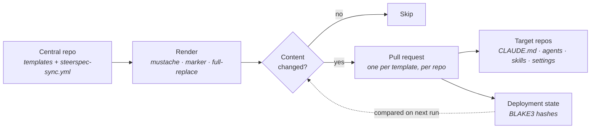

# SteerSpec Sync

SteerSpec Sync is a Go CLI and GitHub Action for platform and engineering teams that distribute AI configuration
files (`CLAUDE.md`, `.claude/agents/`, `.claude/skills/`, `.claude/settings.json`) from one central repo to every
repository in a GitHub organization, by pull request.

<!-- markdownlint-disable MD013 -->
[](https://github.com/SteerSpec/strspc-sync/actions/workflows/ci.yml)
[](https://github.com/SteerSpec/strspc-sync/releases)
[](https://go.dev)
[](LICENSE)
[](https://github.com/marketplace/actions/steerspec-sync)
<!-- markdownlint-enable MD013 -->

Pre-1.0; the latest release is [v0.4.1](https://github.com/SteerSpec/strspc-sync/releases/tag/v0.4.1).
Nothing is force-pushed and nothing is merged for you: every change lands as a reviewable pull request in the
target repo. The behaviour is specified by the `dev.steerspec.sync` realm, linked under
[Specification](#specification).

## Installation

### GitHub Action

Use the composite actions directly from the Marketplace:

```yaml
# Full action (specify command)
- uses: SteerSpec/strspc-sync@v0.4.1
  with:
    command: sync

# Convenience sub-actions
- uses: SteerSpec/strspc-sync/sync@v0.4.1
- uses: SteerSpec/strspc-sync/monitor@v0.4.1
- uses: SteerSpec/strspc-sync/conflict@v0.4.1
```

#### Keeping the pin current

Pin an exact tag, never a branch: the action downloads the binary named by the `VERSION` file at that tag, and a
sync run opens or updates pull requests in the target repositories whose rendered content changed. Nothing moves
an exact pin for you, so let Dependabot open a pull request for each new release:

```yaml
# .github/dependabot.yml
version: 2
updates:
  - package-ecosystem: github-actions
    directory: /
    schedule:
      interval: weekly
    groups:
      actions:
        patterns: ["*"]
```

Read the release notes before merging a bump. Sync, monitor and conflict workflows pinned in the same repository
are updated together by the `groups` entry.

### CLI Binary

Download an archive and its `checksums.txt` from
[Releases](https://github.com/SteerSpec/strspc-sync/releases/tag/v0.4.1). Linux ships as `.tar.gz` and macOS as
`.zip`, for `amd64` and `arm64`:

```bash
# Linux (amd64; use linux_arm64 on arm64)
curl -fsSLO https://github.com/SteerSpec/strspc-sync/releases/download/v0.4.1/strspc_0.4.1_linux_amd64.tar.gz
tar xzf strspc_0.4.1_linux_amd64.tar.gz strspc

# macOS (Apple silicon; use darwin_amd64 on Intel)
curl -fsSLO https://github.com/SteerSpec/strspc-sync/releases/download/v0.4.1/strspc_0.4.1_darwin_arm64.zip
unzip strspc_0.4.1_darwin_arm64.zip strspc

sudo mv strspc /usr/local/bin/
```

## Quick Start

1. Create a central repo (e.g. `your-org/steerspec-config`)
2. Add a `steerspec-sync.yml` config and your templates (see [docs/quickstart/](docs/quickstart/) for examples)
3. Add a workflow to sync on push:

```yaml
name: SteerSpec Sync
on:
  push:
    branches: [main]
    paths:
      - 'templates/**'
      - 'steerspec-sync.yml'

jobs:
  sync:
    runs-on: ubuntu-latest
    steps:
      - uses: actions/checkout@v7
      - uses: SteerSpec/strspc-sync/sync@v0.4.1
        with:
          dry-run: false
          token: ${{ secrets.STEERSPEC_TOKEN }}
```

The `token` input defaults to the workflow's own `GITHUB_TOKEN`, which is scoped to the
repository running the workflow and cannot open pull requests anywhere else — so pass a
PAT (or a GitHub App installation token) with `contents` and `pull_requests` write access on
every target repo. For `auth.method: github-app`, pass `app-id` and `private-key` instead.

## Where to go

| If you want to | Go to |
| --- | --- |
| Run it from a workflow | [Installation](#github-action), [example workflows](docs/quickstart/workflows/) |
| Set up your first central repo | [Quick Start](#quick-start) and [docs/quickstart/](docs/quickstart/) |
| Run the CLI locally | [CLI Binary](#cli-binary) and [Commands](#commands) |
| Look up a configuration key | [Configuration](#configuration) and [`SYNCCFG`](rules/SYNCCFG.json) |
| Read the specification | [Specification](#specification) |
| Build, test or contribute | [CONTRIBUTING.md](CONTRIBUTING.md) |
| Report a vulnerability | [Security](#security) |

## How it works

Templates live in one central repo. On every run, `strspc` renders each template for each target
repository, hashes the result with BLAKE3, and compares it against the recorded deployment state.
Only genuine changes become pull requests — an unchanged render is skipped, so re-running is cheap
and quiet.



Each pull request in a target repo is titled `chore(steerspec-sync): update <template-id> to <version>` (the type
and scope are configurable) so commitlint and semantic-PR checks let it through. Two companion commands watch what
happens afterwards — `monitor` reports files that have drifted away from their template, and `conflict` flags
contradictions across the fleet.

## Commands

### sync

Render templates and open PRs in target repositories.

```bash
strspc sync --config steerspec-sync.yml
strspc sync --config steerspec-sync.yml --dry-run
strspc sync --config steerspec-sync.yml --target-filter "my-org/api-*"
strspc sync --config steerspec-sync.yml --template-filter claude-md --force
```

**Action usage:**

```yaml
- uses: SteerSpec/strspc-sync/sync@v0.4.1
  with:
    dry-run: true
    target-filter: 'my-org/api-*'
```

**Outputs:** `prs-created`, `prs-updated`, `repos-skipped`, `errors`, `summary`

### monitor

Check target repositories for configuration drift and create issues.

```bash
strspc monitor --config steerspec-sync.yml
```

**Action usage:**

```yaml
- uses: SteerSpec/strspc-sync/monitor@v0.4.1
```

**Outputs:** `repos-in-sync`, `repos-drifted`, `issues-created`, `issues-closed`, `summary`

### conflict

Detect conflicts across AI configuration files in target repositories.

```bash
strspc conflict --config steerspec-sync.yml
strspc conflict --config steerspec-sync.yml --tiers 1,2
```

**Action usage:**

```yaml
- uses: SteerSpec/strspc-sync/conflict@v0.4.1
  with:
    tiers: '1,2'
```

**Outputs:** `conflicts-found`, `critical-count`, `warning-count`, `info-count`, `summary`

## Configuration

All configuration lives in `steerspec-sync.yml`.
See [docs/quickstart/steerspec-sync.yml](docs/quickstart/steerspec-sync.yml) for an example
and the `SYNCCFG` entity in [`rules/`](rules/SYNCCFG.json) for the specification of every key.

## Specification

The SteerSpec Sync specification is the `dev.steerspec.sync` realm in
[`rules/` at v0.4.1](https://github.com/SteerSpec/strspc-sync/tree/v0.4.1/rules):
166 rules across 11 entities (configuration, manifest, templates, sync, monitor and conflict
actions, deployment state, component registry, versioning), depending on
[`dev.steerspec.core`](https://github.com/SteerSpec/strspc-rules). Rules are authored with the
[`strspc` CLI](https://github.com/SteerSpec/strspc-CLI) (`strspc rule add`, `strspc rule promote`)
and validated in CI (`strspc realm validate`, `strspc lint`, `strspc diff`); every pull request is
also evaluated against them by `strspc check`.

## Contributing

Bug reports and pull requests are welcome — see [CONTRIBUTING.md](CONTRIBUTING.md) for the build,
test, and lint workflow.

Pull requests to `main` are reviewed automatically by GitHub Copilot. When that review
comes back clean, [`pr-auto-approve`](https://github.com/SteerSpec/strspc-pr-review)
posts the approving review as `cnslr-bt`, which satisfies the required-approval rule — so
an approval from a bot you have never met is expected, not a misconfiguration.

It approves only when every check has passed and Copilot's latest review is clean for the
current commit. A push after Copilot reviewed dismisses the approval until Copilot
re-reviews, and `CHANGES_REQUESTED` always blocks.

## License

Apache 2.0 -- see [LICENSE](LICENSE).

## Security

To report a security issue privately, email <security@steerspec.dev> and do not open a public issue. See
[SECURITY.md](SECURITY.md) for what to include and the response timeline.

## Related projects

Part of the [SteerSpec](https://steerspec.dev) ecosystem:

- [strspc-rules](https://github.com/SteerSpec/strspc-rules) — canonical rule format specification
- [strspc-manager](https://github.com/SteerSpec/strspc-manager) — core enforcement engine
- [strspc-CLI](https://github.com/SteerSpec/strspc-CLI) — render, validate, and manage rule files
