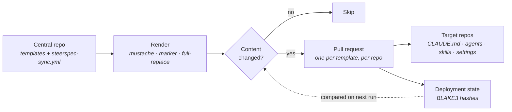

# How it works

Templates live in one central repo. On every run, `strspc` renders each template for each target
repository, hashes the result with BLAKE3, and compares it against the recorded deployment state.
Only genuine changes become pull requests — an unchanged render is skipped and opens no pull request.

Each pull request in a target repo is titled `chore(steerspec-sync): update <template-id> to <version>` (the type
and scope are configurable) so commitlint and semantic-PR checks let it through. Two companion commands watch what
happens afterwards — `monitor` reports files that have drifted away from their template, and `conflict` flags
contradictions across the fleet.
