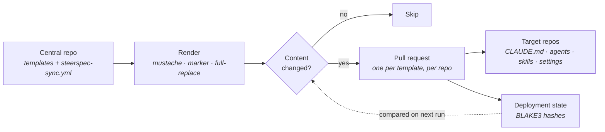

# How it works

Templates live in one central repo. On every run, `strspc` renders each template for each target
repository, hashes the result with BLAKE3, and compares it against the recorded deployment state.
Unless `--force` is set, a pull request opens only when the BLAKE3 hash of the rendered content differs from the
recorded state and the target's file differs from the render; an unchanged render is skipped.

Source at v0.4.1: [BLAKE3 hashing][hash]; the [sync flow][sync], which only creates branches and pull requests (no
ref force-update, no merge call); and the [binary download from the `VERSION` file][action].

[hash]: https://github.com/SteerSpec/strspc-sync/blob/v0.4.1/internal/hash/blake3.go
[sync]: https://github.com/SteerSpec/strspc-sync/blob/v0.4.1/internal/sync/sync.go
[action]: https://github.com/SteerSpec/strspc-sync/blob/v0.4.1/action.yml

Each pull request in a target repo is titled `chore(steerspec-sync): update <template-id> to <version>` (the type
and scope are configurable) so commitlint and semantic-PR checks let it through. Two companion commands watch what
happens afterwards — `monitor` reports files that have drifted away from their template, and `conflict` flags
contradictions across the fleet.
