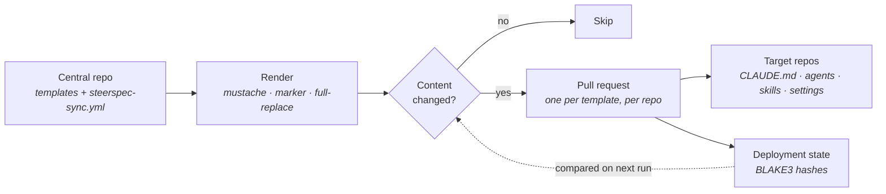

# How it works

Templates live in one central repo. On every run, `strspc` renders each template for each target
repository, hashes the result with BLAKE3, and compares it against the recorded deployment state.
Unless `--force` is set, a pull request opens only when the BLAKE3 hash of the rendered content differs from the
recorded state and the target's file differs from the render; an unchanged render is skipped.

Source at v0.4.1: [BLAKE3 hashing][hash]; the [sync flow][sync], which opens branches and pull requests and
never force-updates a ref or merges; and the [binary download from the `VERSION` file][action].

[hash]: https://github.com/SteerSpec/strspc-sync/blob/v0.4.1/internal/hash/blake3.go
[sync]: https://github.com/SteerSpec/strspc-sync/blob/v0.4.1/internal/sync/sync.go
[action]: https://github.com/SteerSpec/strspc-sync/blob/v0.4.1/action.yml



Each pull request in a target repo is titled `chore(steerspec-sync): update <template-id> to <version>` (the type
and scope are configurable) so commitlint and semantic-PR checks let it through. Two companion commands watch what
happens afterwards — `monitor` reports files that have drifted away from their template, and `conflict` flags
contradictions across the fleet.

## Reviewing and merging sync pull requests

Sync opens one pull request per template in each target repo. Its branch is `steerspec-sync/<template-id>/<version>`
and it carries the `steerspec-sync` label (`sync.pr-label`). So a first run across an org opens about as many pull
requests as there are repos times templates: 30 repos and 6 templates is 180. To get one pull request per repo
instead, set `sync.pr-grouping: repo` (see [One pull request per repo](#one-pull-request-per-repo)).

After that, the count stays small:

- A run updates the open pull request for a template version instead of opening another.
- When a template's version changes, `sync.close-stale-prs` (on by default) closes the older version's pull request
  in that repo, so a repo has at most one open sync pull request per template.
- An unchanged render opens nothing.

Sync never merges. Each pull request goes through the target repo's own CI, reviews and rulesets. To merge them in
bulk, one repo at a time:

```bash
repo=OWNER/REPO
label=steerspec-sync   # your sync.pr-label
gh pr list -R "$repo" --label "$label" --state open --limit 1000 --json number,headRefName \
  -q '.[] | select(.headRefName | startswith("steerspec-sync/")) | .number' |
while read -r n; do
  gh pr merge "$n" -R "$repo" --squash --auto --delete-branch
done
```

- `--auto` merges each pull request once its required checks and reviews pass, so the repo's rulesets still apply.
  It needs **Allow auto-merge** in the repo's settings. Without `--auto`, a pull request that isn't ready fails to
  merge and the loop moves on to the next.
- Use a merge method the repo allows: `--squash`, `--merge` or `--rebase`.
- Set `label` to your `sync.pr-label` if you changed it. With the wrong label, the loop finds nothing to merge.
- `--limit` raises `gh`'s default of 30 results, which would leave the rest unmerged.
- The branch check skips pull requests that carry the label but weren't opened by sync.
- Templates with different `destination`s change different files, so their pull requests don't conflict. Two
  templates with the same `destination`, such as two marker sections of `CLAUDE.md`, can: once one is merged, the
  other may need its conflict resolved before it merges.

To find the repos that have open sync pull requests:

```bash
label=steerspec-sync   # your sync.pr-label
gh search prs --owner ORG --label "$label" --state open --limit 1000 \
  --json repository -q '.[].repository.nameWithOwner' | sort -u
```

### One pull request per repo

With `sync.pr-grouping: repo`, a run opens or updates one pull request per target repo. It carries every template
that is out of date for that repo and renders without error:

- **Branch:** `steerspec-sync/repo/<hash>`. The hash is the first 8 hex characters of the BLAKE3 hash of the sorted
  `<template-id>@<version>` list, joined by newlines.
  - New content at the same versions adds a commit to the open pull request.
  - A version change opens a new pull request, which carries the unchanged templates too, and closes the old one.
- **Commit:** each run adds one commit with every file that changed. Templates that share a `destination` are rendered
  onto the same file one after another, so they don't conflict with each other. They must all use the `marker`
  strategy, since `mustache` and `full-replace` overwrite the file; config validation rejects anything else. They
  must also manage different sections, and each must have at least one: a marker template without sections replaces
  the whole file. A template that would overwrite another one's section is reported as an error and left out of the
  pull request.
- **Title and body:** the title is `<pr-title-prefix>: update <n> templates`, or the usual per-template title for a
  single template. The body has one section per template, with its previous and new version, changelog and diff link.
- **One template fails:** a template that can't be read or rendered is reported in the run result, and the pull
  request ships the others. When it renders again, the version set changes and a new pull request replaces the old
  one.
- **Filtered runs:** a run with `--template-filter` builds its bundle from the matching templates only, so it replaces
  an open bundle that carries more. The templates it leaves out are proposed again by the next unfiltered run.
- **Switching modes:** with `close-stale-prs` on, the first bundle closes the open per-template pull requests for the
  templates it carries. Back in `template` mode, the first per-template pull request closes the open bundle, and sync
  proposes the bundle's other templates again on its next run.

The trade-off is that a repo takes the bundle as a whole: it can't merge one template and hold back another.
